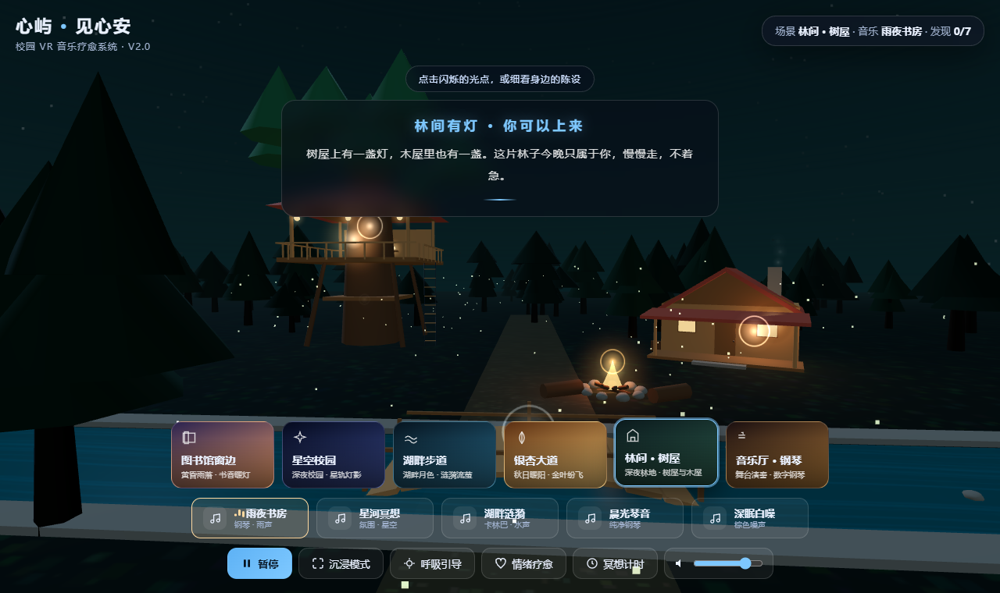
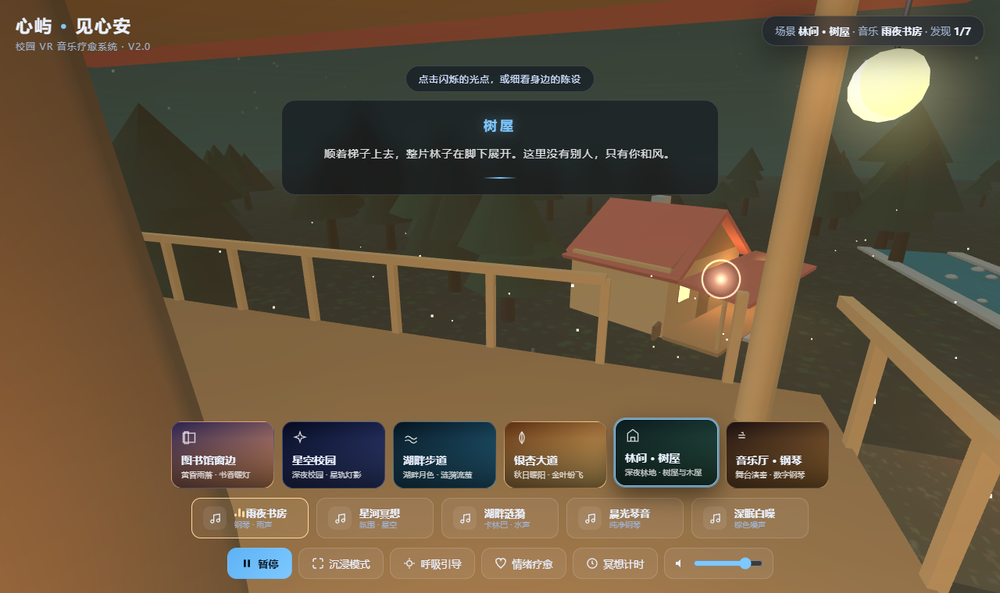
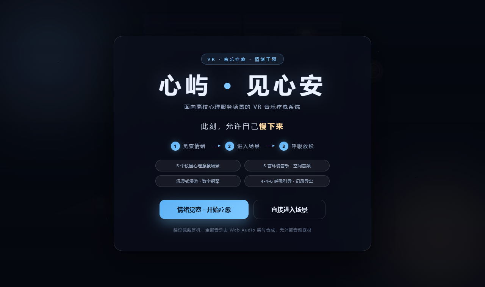
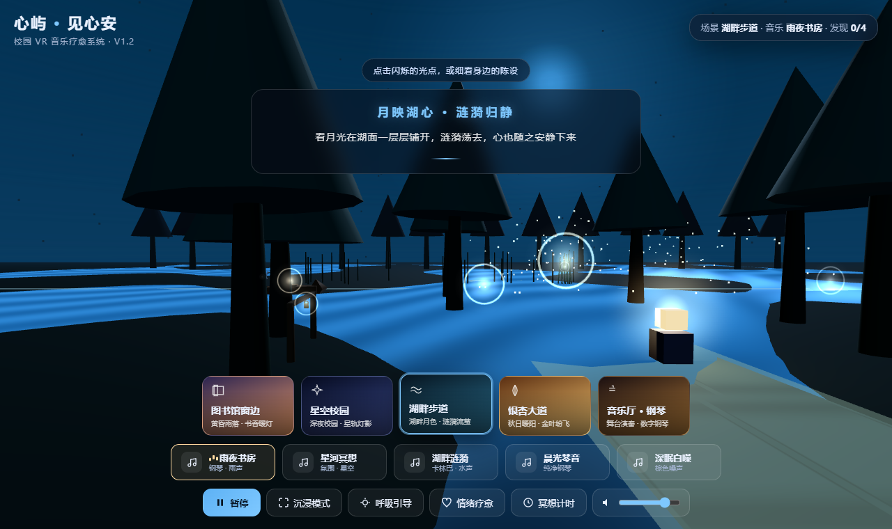
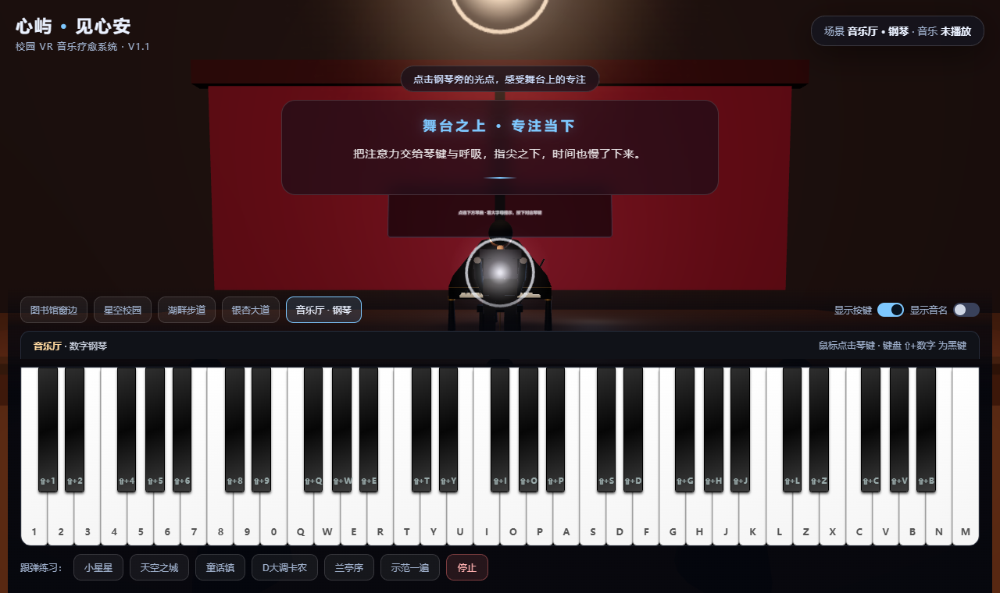

# 心屿 · 见心安

面向高校心理服务场景的 **VR-音乐疗愈系统**（V2.0 大地图版）

> 课题《面向高校心理服务场景的 VR-音乐疗愈系统构建及其对大学生负性情绪的干预实证研究》配套成果

一个打开就能用的网页版沉浸式疗愈空间：**六个场景**（含一片可漫游的林地）、树屋与木屋等大型地标、八种自然声景、120 处可探查物件、数字钢琴、4-4-6 呼吸引导与冥想计时。**无需安装、无需头显、无需联网。**

### 👉 在线体验：<https://17762396674-star.github.io/xinyu/>

### 大地图：林间 · 树屋

新增的林地场景不是"多摆几个小物件"，而是一整片可以走进去的地方——树屋、木屋、营火、溪流与石桥分布在小径两侧，点击树屋，镜头会升到平台俯瞰整片林子。

## 这是什么

大学生日常的负性情绪（学业压力、人际焦虑、情绪内耗）缺少一个"随时可用、门槛很低"的出口。心屿把 VR 的沉浸感与音乐治疗的节律调节拆解成浏览器里的轻量体验：觉察情绪 → 进入场景 → 呼吸放松，几分钟完成一次有仪式感的情绪休整。

设计遵循「沉浸—共鸣—调节」三阶段模型：场景营造在场感与注意力转移，声景与视听节律形成感官共振，呼吸引导、冥想与主动演奏完成情绪调节。

## 功能

| 模块 | 说明 |
| --- | --- |
| 情绪觉察 | 焦虑 / 低落 / 烦躁 / 疲惫 / 平静 五态自选，自动推荐场景与曲目 |
| 疗愈场景 | 图书馆窗边、星空校园、湖畔步道、银杏大道、**林间·树屋**、音乐厅·钢琴，第一人称漫游 |
| 大型地标 | 树屋（平台/敞廊/灯笼/绳梯）、木屋（门廊/亮窗/炊烟）、营火、石拱桥、溪流、水榭栈桥、六角凉亭 |
| 镜头飞行 | 点击树屋升到平台俯瞰全林；点击木屋门打开并走到门前 |
| 分级音乐 | 雨夜书房、星河冥想、湖畔涟漪、晨光琴音、深眠白噪，配合 8 种环境声景与 HRTF 空间音频 |
| 交互热点 | 每个场景 3 个可点击光点（点亮书灯、许愿流星、荡开涟漪……），触发专属微动画与引导文案 |
| 呼吸引导 | 4-4-6 箱式呼吸，节奏与场景光影联动 |
| 冥想计时 | 3 / 5 / 10 分钟，结束后 1–5 分自评，可导出记录 |
| 数字钢琴 | 61 键，鼠标与键盘双演奏，5 首简谱跟弹（小星星、天空之城、童话镇、D大调卡农、兰亭序）与自动示范 |
| 场景探索 | 每个场景 24 处可探查物件（4 处定制 + 20 处陈设），按亮度分明显 / 微光 / 隐藏三档 |
| 探索激励 | 顶栏「发现 n/m」计数；集齐一个场景得 1 枚心屿印记，集满 5 枚解锁隐藏曲目《心屿 · 回声》 |

## 探索什么

场景里的物件不是背景板——点一下，它们会动、会响、会说话。

| 场景 | 定制物件 | 常设陈设（部分） | 隐藏线索 |
| --- | --- | --- | --- |
| 图书馆窗边 | 温茶、窗台绿植、停摆的挂钟、木箱 | 茶壶、钢笔、眼镜、笔记本、相框、收音机、地球仪、地毯、毛毯、雨伞、纸鹤…… | 箱底纸条、词典里的车票、墙上明信片 |
| 星空校园 | 长椅、深夜售货机、自行车、草丛 | 公告栏、灯箱、垃圾桶、消防栓、吉他、躺椅、气球、看台、篮球、路牌、猫窝…… | 草里的猫、萤火罐、树上的风筝 |
| 湖畔步道 | 许愿锁、岸边小舟、芦苇丛 | 木栈道、渔具箱、鱼竿、水桶、睡莲、石子、野餐垫、相机、三脚架、喂鸟器…… | 纸船、浮标、水边的白鹭 |
| 银杏大道 | 风铃、老邮筒、落叶堆 | 画架、颜料盒、野餐篮、围巾、打盹的狗、路牌、石凳、栗子袋、纸风车…… | 刻年份的木牌、纸灯笼、水洼 |
| 音乐厅 | 谱架乐谱、舞台边的花、红丝绒幕布 | 竖琴、大提琴盒、定音鼓、指挥棒、琴凳、吊灯、奖杯、海报、红地毯、小提琴…… | 节目单、幕布绳、停走的墙钟 |
| 林间·树屋 | 树屋、木屋、营火、溪流 | 林地、苔石、蘑菇、柴堆、木桶、吊灯、鸟窝…… | 树屋上的灯、木屋门缝里的光 |

每个场景 24 处左右，全部发现可得一枚心屿印记（共 6 枚）。隐藏线索只有极暗的微光，靠近细看才会亮起来——它们构成了这个空间的另一层叙事。集齐五枚印记后，音乐列表会多出一首不对外开放的《心屿 · 回声》。

## 打开方式

**在线体验**：<https://17762396674-star.github.io/xinyu/> （手机浏览器同样可用，建议横屏）

**本地打开**：下载 `index.html`，双击用 Chrome / Edge / Safari 打开。全部代码与三维引擎都在这一个文件里，断网也能运行。

**手机体验**：把 `index.html` 发到手机用浏览器打开，支持单指环视、双指缩放；建议横屏。

> 建议佩戴耳机。所有声音由浏览器实时合成，没有音频素材文件。

## 技术实现

- **单文件交付**：一个 `index.html`（约 850 KB），three.js r160 与 OrbitControls 已内联，全程零外部请求，可离线运行。
- **音频零素材**：钢琴、钟琴、卡林巴、噪声全部由 Web Audio API 用振荡器、滤波器与包络实时合成；音乐厅混响由程序化脉冲响应卷积生成；环境声按场景位置挂 PannerNode，随视角更新听者朝向。
- **程序化场景**：低多边形几何 + Canvas 生成贴图 + 自定义 Shader（星空闪烁、雨丝、水面涟漪、粒子飘落），单场景百级 draw call。
- **移动端适配**：`pointer: coarse` 检测、iOS 无 Vibration API 时用视觉涟漪替代触感、安全区适配、响应式布局。
- **交互音效**：翻页、杯响、风铃、水声、猫叫等全部由振荡器与滤波噪声即时合成，单个音效不超过 1 秒、复用同一 sfxBus，不增加资源体积。
- **大型地标**：树屋/木屋/营火/桥由 `Landmark` 模块用基础几何拼装，配套 `flyTo()` 镜头缓动（三次缓出）实现「走进树屋」的空间感。
- **物件系统**：100 处陈设由「配方 + 数据表」生成（58 种配方 × 位置/文案/动作），单件 2—4 个部件，暗场景自带 22% 自发光以保持可读性。
- **数据**：冥想自评与探索进度写入 `localStorage`，自评支持导出 CSV（被试编号、时间、场景、情绪、时长、自评），可直接进 Excel / SPSS。

## 设计文档

系统定位、设计理念（沉浸—共鸣—调节三阶段模型）、技术方案、五大场景详解、实施路径与 V2 规划，见：

📄 [`docs/心屿网站设计理念与实施方案.docx`](docs/心屿网站设计理念与实施方案.docx)

## 用于研究时

1. 每次冥想结束后填写被试编号（如 A01），选择自评分数并记录；
2. 阶段回收时点「导出记录 CSV（研究用）」；
3. 建议固定设备与浏览器，实验期间不清除浏览器数据。

## 已知限制

- 记录保存在本机浏览器，换设备或清缓存后不可恢复，仅适合单机采集；
- 采集的是主观自评数据，尚未接入心率变异性、皮肤电等生理指标；
- 探索记录（发现/印记）与冥想记录分别存在两个 key，尚未合并导出；
- 分级疗程编排与多人数据汇总列入 V2 开发范围；
- 立体场景依赖 WebGL，极旧设备会给出提示而无法进入。

## 声明

本系统定位为日常情绪放松与压力舒缓工具，**不用于心理疾病诊断与治疗**。如有持续情绪困扰，请寻求学校心理健康中心或专业医疗机构的帮助。

课题文档、实验工具与原始数据不随本仓库公开。
