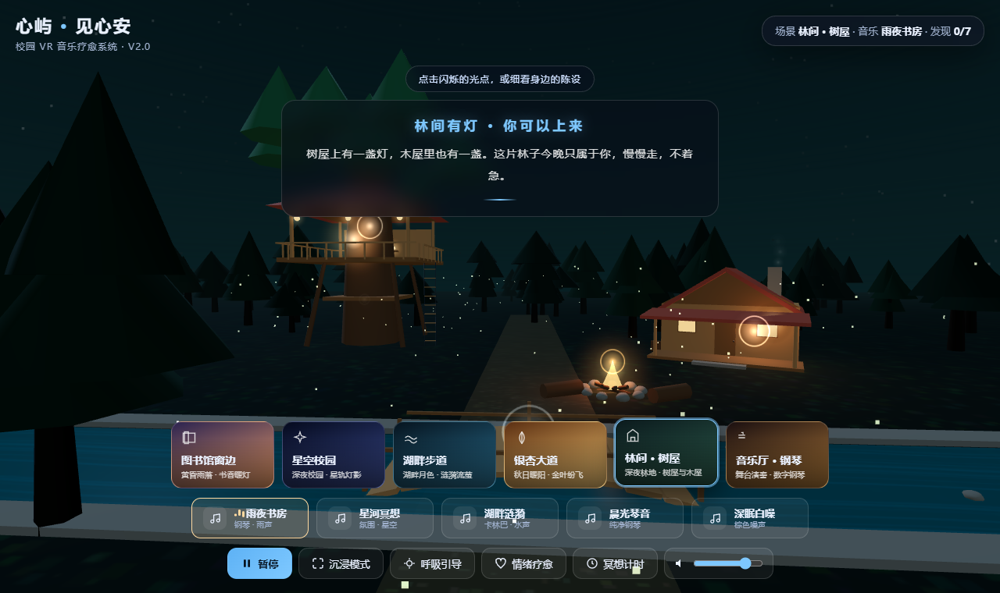
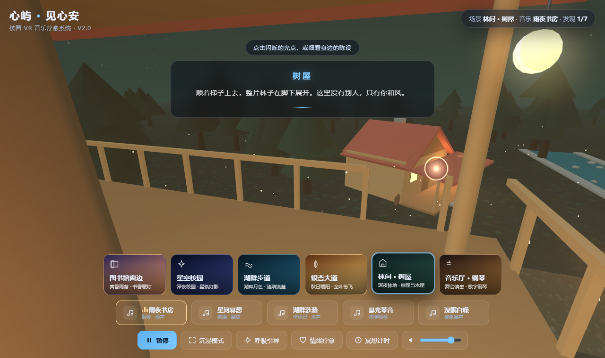
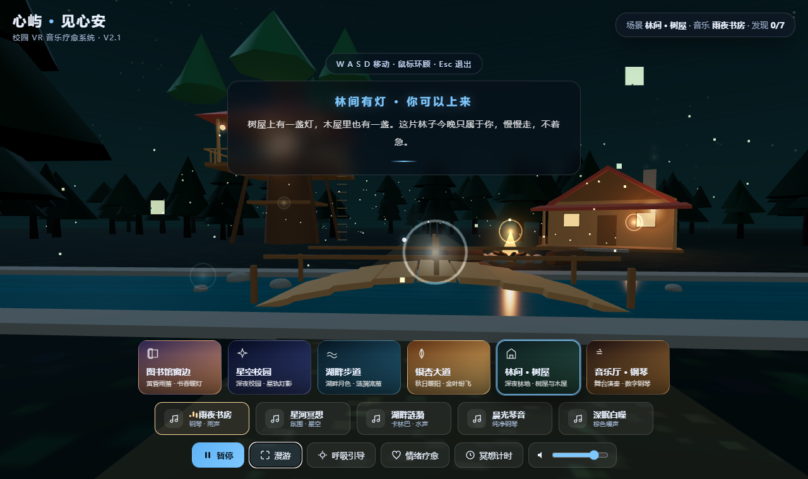
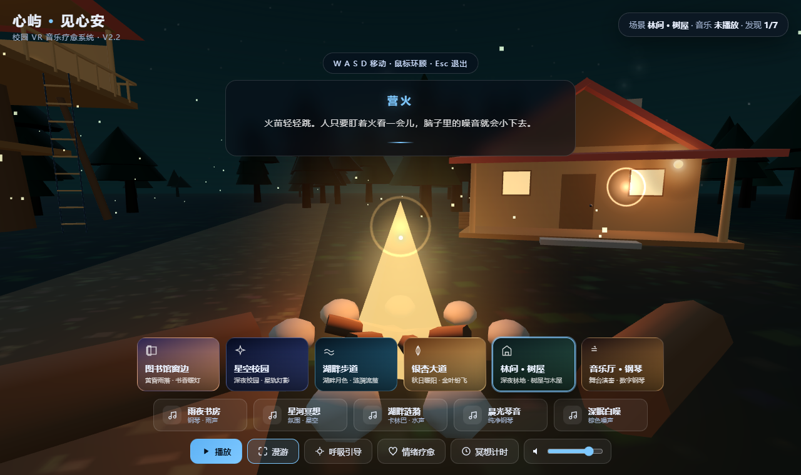
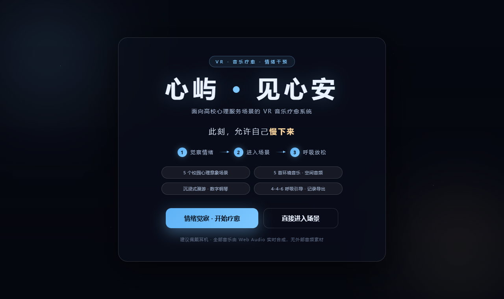
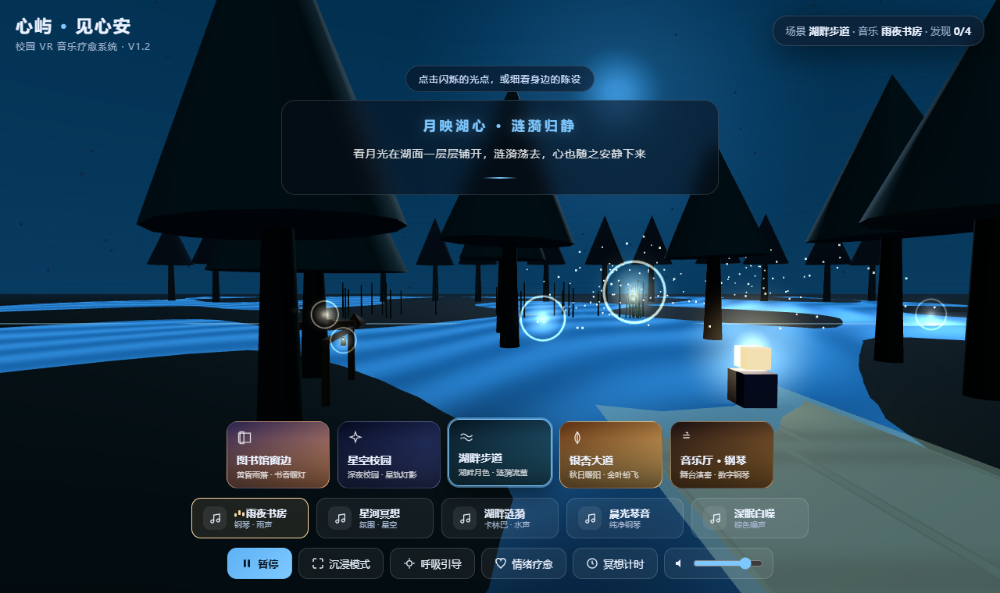
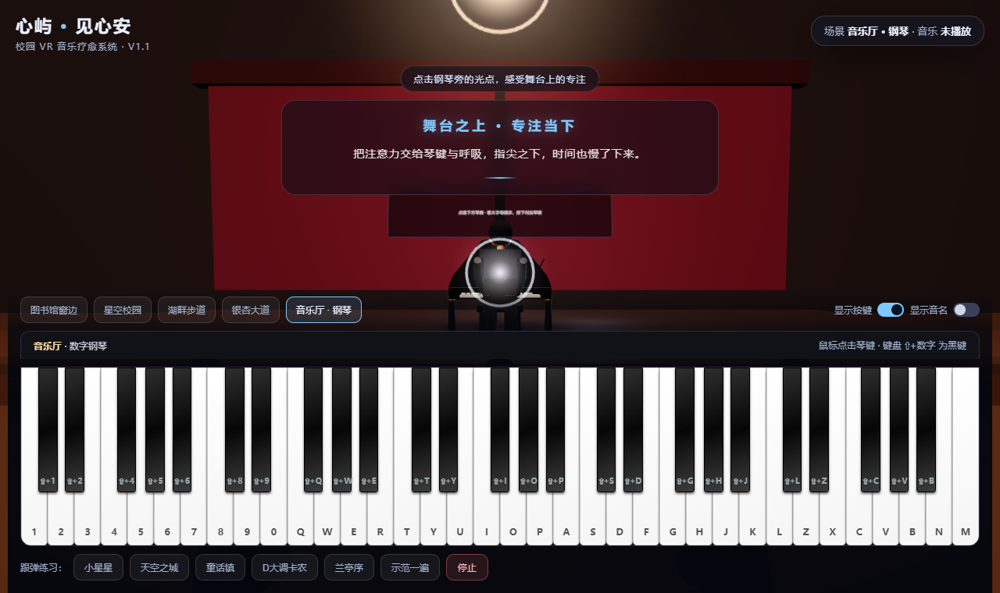

# 心屿 · 见心安

面向高校心理服务场景的 **VR-音乐疗愈系统**（V2.2 可走近版）

> 课题《面向高校心理服务场景的 VR-音乐疗愈系统构建及其对大学生负性情绪的干预实证研究》配套成果

一个打开就能用的网页版沉浸式疗愈空间：**六个场景**（含一片可漫游的林地）、树屋与木屋等大型地标、八种自然声景、120 处可探查物件、数字钢琴、4-4-6 呼吸引导与冥想计时。**无需安装、无需头显、无需联网。**

### 👉 在线体验：<https://17762396674-star.github.io/xinyu/>

### 大地图：林间 · 树屋

新增的林地场景不是"多摆几个小物件"，而是一整片可以走进去的地方——树屋、木屋、营火、溪流与石桥分布在小径两侧，点击树屋，镜头会升到平台俯瞰整片林子。

### 走进去，而不是绕着看

点底部「漫游」进入第一人称行走：镜头降到 1.6 米视高，WASD 走动、鼠标环顾，会被书架、凉亭、树屋自然挡住；走到木屋门口会自动开门。手机上换成左下角摇杆 + 右侧拖动转视角。

### 点一下，就走过去

不想一步步挪？直接点场景里任何一个能走近的物件——茶、长椅、小舟、梯子、营火、凉亭、水榭、钢琴——镜头会平滑过渡到它跟前：漫游时是第一人称走过去并自然转头，未进入漫游时是镜头飞过去。走过头了按一下方向键就能随时接管。

## 这是什么

大学生日常的负性情绪（学业压力、人际焦虑、情绪内耗）缺少一个"随时可用、门槛很低"的出口。心屿把 VR 的沉浸感与音乐治疗的节律调节拆解成浏览器里的轻量体验：觉察情绪 → 进入场景 → 呼吸放松，几分钟完成一次有仪式感的情绪休整。

设计遵循「沉浸—共鸣—调节」三阶段模型：场景营造在场感与注意力转移，声景与视听节律形成感官共振，呼吸引导、冥想与主动演奏完成情绪调节。

## 功能

| 模块 | 说明 |
| --- | --- |
| 情绪觉察 | 焦虑 / 低落 / 烦躁 / 疲惫 / 平静 五态自选，自动推荐场景与曲目 |
| 疗愈场景 | 图书馆窗边、星空校园、湖畔步道、银杏大道、**林间·树屋**、音乐厅·钢琴，第一人称漫游 |
| 大型地标 | 树屋（平台/敞廊/灯笼/绳梯）、木屋（门廊/亮窗/炊烟）、营火、石拱桥、溪流、水榭栈桥、六角凉亭 |
| 镜头飞行 | 点击树屋升到平台俯瞰全林；点击木屋门打开并走到门前 |
| 走近物件 | 六个场景共 25 处可走近的物件/地标，点一下即平滑过渡到它跟前（漫游=走过去并转头，非漫游=镜头飞行） |
| 自由漫游 | 桌面 WASD + 鼠标环顾（指针锁定），手机虚拟摇杆 + 右侧拖拽；带边界与碰撞，靠近门口自动触发 |
| 分级音乐 | 雨夜书房、星河冥想、湖畔涟漪、晨光琴音、深眠白噪，配合 8 种环境声景与 HRTF 空间音频 |
| 音乐库 | 共 510 首：10 个疗愈场景 × 18 首（雨夜 / 清晨 / 林间 / 海岸 / 星空 / 炉火 / 山径 / 旧屋 / 城市黄昏 / 书房），加 **330 首有据可查的古典名曲**（20 首精选 + 100 首批次收录 + 五大家各 50 首）。巴赫、莫扎特、贝多芬、肖邦、柴可夫斯基各自独立成专辑，一曲一条 BWV / K. / Op. 编号可查。左栏按曲库 / 歌单 / 场景专辑 / 演奏风格 / 艺术家五类浏览，支持关键词搜索（含「森林」「失眠」「专注」这类场景近义词，命中词会高亮）、六种排序、收藏与自建歌单，点曲即播，含暂停续播、上一首 / 下一首、拖动进度、三种播放模式与**睡眠定时**（5/10/20/30/45/60 分钟或「听完这一首」，到点前 20 秒淡出）；「播放全部 / 随机播放」一键开一轮，播放条的**队列计数**（第 n / 共 m 首）点开可看接下来放什么、跳播或从队列移除；方向键 ↑↓ 选行、Enter 播放、F 收藏；打开音乐库会自动暂停场景背景音乐，关面板时若没在播放则接回去，关掉面板后右下角留一条**迷你播放条**（暂停 / 回库 / 进度）；刷新后回到上次那一首的进度，只显示不自动出声；支持**系统媒体控制**，手机锁屏、通知栏与耳机线控都能暂停与切歌 |
| 交互热点 | 每个场景 3 个可点击光点（点亮书灯、许愿流星、荡开涟漪……），触发专属微动画与引导文案 |
| 呼吸引导 | 4-4-6 箱式呼吸，节奏与场景光影联动 |
| 冥想计时 | 3 / 5 / 10 分钟，结束后 1–5 分自评，可导出记录 |
| 数字钢琴 | 61 键，鼠标与键盘双演奏，5 首简谱跟弹（小星星、天空之城、童话镇、D大调卡农、兰亭序）与自动示范 |
| 场景探索 | 每个场景 24 处可探查物件（4 处定制 + 20 处陈设），按亮度分明显 / 微光 / 隐藏三档 |
| 探索激励 | 顶栏「发现 n/m」计数；集齐一个场景得 1 枚心屿印记，集满 5 枚解锁隐藏曲目《心屿 · 回声》 |

## 探索什么

场景里的物件不是背景板——点一下，它们会动、会响、会说话。

| 场景 | 定制物件 | 常设陈设（部分） | 隐藏线索 |
| --- | --- | --- | --- |
| 图书馆窗边 | 温茶、窗台绿植、停摆的挂钟、木箱 | 茶壶、钢笔、眼镜、笔记本、相框、收音机、地球仪、地毯、毛毯、雨伞、纸鹤…… | 箱底纸条、词典里的车票、墙上明信片 |
| 星空校园 | 长椅、深夜售货机、自行车、草丛 | 公告栏、灯箱、垃圾桶、消防栓、吉他、躺椅、气球、看台、篮球、路牌、猫窝…… | 草里的猫、萤火罐、树上的风筝 |
| 湖畔步道 | 许愿锁、岸边小舟、芦苇丛 | 木栈道、渔具箱、鱼竿、水桶、睡莲、石子、野餐垫、相机、三脚架、喂鸟器…… | 纸船、浮标、水边的白鹭 |
| 银杏大道 | 风铃、老邮筒、落叶堆 | 画架、颜料盒、野餐篮、围巾、打盹的狗、路牌、石凳、栗子袋、纸风车…… | 刻年份的木牌、纸灯笼、水洼 |
| 音乐厅 | 谱架乐谱、舞台边的花、红丝绒幕布 | 竖琴、大提琴盒、定音鼓、指挥棒、琴凳、吊灯、奖杯、海报、红地毯、小提琴…… | 节目单、幕布绳、停走的墙钟 |
| 林间·树屋 | 树屋、木屋、营火、溪流 | 林地、苔石、蘑菇、柴堆、木桶、吊灯、鸟窝…… | 树屋上的灯、木屋门缝里的光 |

每个场景 24 处左右，全部发现可得一枚心屿印记（共 6 枚）。隐藏线索只有极暗的微光，靠近细看才会亮起来——它们构成了这个空间的另一层叙事。集齐六枚印记后，音乐列表会多出一首不对外开放的《心屿 · 回声》。

其中 25 处物件可以「点一下就走过去」：它们多半是场景里有实体的大件——书桌、长椅、自行车、售货机、小舟、邮筒、谱架、琴盖、营火、石桥、绳梯，以及凉亭、水榭、树屋三处建筑。走近后光点会自动收敛，不会糊住视线。

## 打开方式

**在线体验**：<https://17762396674-star.github.io/xinyu/> （手机浏览器同样可用，建议横屏）

**本地打开**：下载 `index.html`，双击用 Chrome / Edge / Safari 打开。全部代码与三维引擎都在这一个文件里，断网也能运行。

**手机体验**：把 `index.html` 发到手机用浏览器打开，支持单指环视、双指缩放；建议横屏。

> 建议佩戴耳机。所有声音由浏览器实时合成，没有音频素材文件。

## 技术实现

- **单文件交付**：一个 `index.html`（约 1.22 MB），three.js r160 与 OrbitControls 已内联，全程零外部请求，可离线运行。
- **音频零素材**：钢琴、钟琴、卡林巴、噪声全部由 Web Audio API 用振荡器、滤波器与包络实时合成；音乐厅混响由程序化脉冲响应卷积生成；环境声按场景位置挂 PannerNode，随视角更新听者朝向。
- **音乐库管理**：曲目按 23 张专辑（10 个疗愈场景 + 5 张作曲家专辑 + 4 张古典精选 + 4 张典藏）与 9 种风格（5 种疗愈语汇 + 4 个乐派）归类；同一首作品可同时属于乐派典藏与作曲家专辑，作曲家专辑内按创作年代排列；210 首新曲逐首实测 RMS 与峰值后落到同一响度档（目标 0.045、峰值 ≤0.62），切歌不再忽大忽小，筛选与搜索在前端完成；收藏、歌单、最近播放、排序偏好、断点续听与主音量写入 localStorage（`xinyu_lib_fav_v1` / `xinyu_lib_pl_v2` / `xinyu_lib_recent_v1` / `xinyu_lib_pref_v1` / `xinyu_lib_last_v1` / `xinyu_vol_v1`），刷新与离线下一致保留。
- **播放队列**：按下播放时把当前列表做一份快照当队列，之后换筛选、改排序都不会打断这一轮；队列浮层可看来源、当前第几首、接下来十几首，支持跳播与单项移除，「清空后续」只留正在放的这首；随机播放会打乱队列并切到随机模式。关闭面板后由迷你播放条接管控制，位置按控制台高度实时计算，不遮挡底部按钮。
- **声音让路与睡眠定时**：开呼吸引导或冥想时，曲库与场景环境音一起压到 40%，关闭后自动恢复；睡眠定时统管两个音源，最后 20 秒线性淡出再停，不会突然断掉；页面切到后台时调度前瞻自动放宽，回到前台立即补排，避免断音与漏切。
- **系统媒体会话**：通过 Media Session API 把曲名、作曲家、专辑与唱片封面（按专辑色现场绘制的内联 SVG）交给系统，锁屏 / 通知栏 / 蓝牙耳机按键可播放、暂停、上一首、下一首与拖动进度，进度条随播放同步。
- **疗愈曲库**：180 首不存音频，而是由「音阶 + 和弦级数 + 速度 + 织体 + 随机种子」在播放前现场编排（确定性随机：同一组参数永远是同一首）；五种演奏语汇对应不同音色与织体，音域统一收在 C2–E6，逐风格做过混音校准，切换时响度一致。
- **古典曲库**：20 首名曲以「旋律音名 + 小节拍数 + 和弦进行 + 织体类型」存成乐谱数据，再由调度器按拍前瞻排布声部（琶音 / 圆舞曲 / 柱式和弦 / 进行曲脉冲四种织体，钢琴、弦乐、铃音三种音色），支持任意位置续播与循环；配有逐曲混音校准表，切换曲目时响度一致。
- **程序化场景**：低多边形几何 + Canvas 生成贴图 + 自定义 Shader（星空闪烁、雨丝、水面涟漪、粒子飘落），单场景百级 draw call。
- **移动端适配**：`pointer: coarse` 检测、iOS 无 Vibration API 时用视觉涟漪替代触感、安全区适配、响应式布局。
- **交互音效**：翻页、杯响、风铃、水声、猫叫等全部由振荡器与滤波噪声即时合成，单个音效不超过 1 秒、复用同一 sfxBus，不增加资源体积。
- **漫游系统**：行走态下接管相机（暂停 OrbitControls），按场景配置 `walk`（视高 / 边界 / 圆形碰撞体 / 近距触发点）；移动端用 Pointer Events 实现摇杆与转视角。
- **走近（approach）**：热点可选 `go`（停留距离 / 注视点），触发时按「从物件朝相机方向后退」算出落点，缓存边界；漫游态用 `walkTo` 缓动位置并插值 yaw/pitch（走到跟前自然转头），非漫游态复用 `flyTo` 镜头飞行。指针锁定下改用准星（屏幕中心）拾取。
- **大型地标**：树屋/木屋/营火/桥由 `Landmark` 模块用基础几何拼装，配套 `flyTo()` 镜头缓动（三次缓出）实现「走进树屋」的空间感。
- **物件系统**：100 处陈设由「配方 + 数据表」生成（58 种配方 × 位置/文案/动作），单件 2—4 个部件，暗场景自带 22% 自发光以保持可读性。
- **数据**：冥想自评与探索进度写入 `localStorage`，自评支持导出 CSV（被试编号、时间、场景、情绪、时长、自评），可直接进 Excel / SPSS。

## 设计文档

系统定位、设计理念（沉浸—共鸣—调节三阶段模型）、技术方案、五大场景详解、实施路径与 V2 规划，见：

📄 [`docs/心屿网站设计理念与实施方案.docx`](docs/心屿网站设计理念与实施方案.docx)

## 用于研究时

1. 每次冥想结束后填写被试编号（如 A01），选择自评分数并记录；
2. 阶段回收时点「导出记录 CSV（研究用）」；
3. 建议固定设备与浏览器，实验期间不清除浏览器数据。

## 已知限制

- 记录保存在本机浏览器，换设备或清缓存后不可恢复，仅适合单机采集；
- 采集的是主观自评数据，尚未接入心率变异性、皮肤电等生理指标；
- 探索记录（发现/印记）与冥想记录分别存在两个 key，尚未合并导出；
- 分级疗程编排与多人数据汇总列入 V2 开发范围；
- 立体场景依赖 WebGL，极旧设备会给出提示而无法进入。

## 声明

本系统定位为日常情绪放松与压力舒缓工具，**不用于心理疾病诊断与治疗**。如有持续情绪困扰，请寻求学校心理健康中心或专业医疗机构的帮助。

课题文档、实验工具与原始数据不随本仓库公开。
